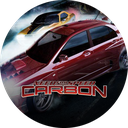

<a id="readme-top"></a>

<div align="center">



<h3 align="center">NFSCVITA</h3>

<p align="center">
  <b>Need for Speed Carbon, on the PS Vita</b>
  <br />
  <br />
  A static recompilation of Need for Speed Carbon (PC, 2006) to the PS Vita, with a native sceGxm renderer.
  <br />
  <br />
  <a href="#install">Install</a>
  &nbsp;·&nbsp;
  <a href="#controls">Controls</a>
  &nbsp;·&nbsp;
  <a href="../../issues">Report Bug</a>
</p>

[![issues][issues-shield]][issues-url]&nbsp;[![last commit][commit-shield]][commit-url]

[![platform][platform-shield]][platform-url]&nbsp;[![resolution][resolution-shield]][resolution-url]&nbsp;[![renderer][renderer-shield]][renderer-url]&nbsp;[![license][license-shield]][license-url]

</div>

> **Status: in development.** No release yet.

## Requirements

- Need for Speed Carbon for PC, version 1.4, unprotected `NFSC.exe`
  (SHA-256 `baaaaec33873d4ba7e4dbae6a5212049ffdcf9679a35d865d7625b4189952fd3`)
- PS Vita with HENkaku/Enso
- ARM clock at 500 MHz (e.g. PSVshell)
- Optional: CapUnlocker (fourth CPU core)

## Install

1. Install `NFSCVITA.vpk`.
2. Copy the game folder's contents (`NFSC.exe` and the data folders) to `ux0:data/NFSCVITA/`.

## Controls

### Menus

| Button | Action |
|--------|--------|
|  | Accept, skip movie or intro |
|  | Back |
|  | Start, skip movie |
|   | Navigate |
|  | Rotate car view |
|  /  | Previous / next |
|  /  | Screen options 4 / 5 |
| Rear touch, left / right | Screen options 1 / 0 |
|  | Screen option 2 |

### Driving

| Button | Action |
|--------|--------|
|  | Accelerate |
|  | Brake / reverse |
|  | Steer |
|  | Nitrous |
|  | Handbrake |
|  | Camera |
|  | Look back |
|  | Pause |
|  | Reset car |
|  up / down | Shift up / down (manual) |
|  / rear touch, right | Speedbreaker |
| Rear touch, left | Crew ability |
|  | Enter event |
|  | World map |
|  | Messages |
| Front touch, top | Next song |

Text fields open the Vita keyboard.

## Known issues

- Races run below 30 fps.
- Wrong address calls needs to be corrected
- OOM issues while loading some bigger career cutscenes

## Build

Requirements: [VitaSDK](https://vitasdk.org) (`VITASDK`), LLVM with clang and lld (`NFSC_LLVM`), Python 3,
PowerShell. Variables can also go in `tools/env.local.ps1`.

```powershell
tools/build.ps1 -Game <folder with NFSC.exe> -Compiler clang   # -> build-release-clang/NFSCVITA.vpk
```

- The recompiled code is generated from your own `NFSC.exe`; no game code or data is in this repository.
- Shaders ship prebuilt in `shaders/gxp/`.
- Development settings: [docs/settings.md](docs/settings.md).

| Path | Contents |
|------|----------|
| `include/` | virtual x86 CPU, runtime, Win32 and platform headers |
| `src/lib/` | runtime: guest memory, threads, Win32, C runtime, Direct3D 9 and D3DX |
| `src/platform/` | Vita backend: gxm renderer, audio, input, sync, logging |
| `src/nfsc/` | entry point, native replacements of game functions |
| `shaders/` | Cg shaders and compiled binaries |
| `tools/` | recompiler, build, device and analysis scripts |

## Credits

- [Grarak](https://github.com/Grarak): [psp2-tooling](https://github.com/Grarak/psp2-tooling)
- [GrapheneCt](https://github.com/GrapheneCt): CapUnlocker
- EA Black Box: *Need for Speed Carbon*

## License

MIT for the port's own code ([LICENSE](LICENSE)); third-party parts: [THIRD_PARTY.md](THIRD_PARTY.md).

Unofficial fan port, not affiliated with Electronic Arts. You must own the game.

<!-- BADGES -->

[issues-shield]: https://img.shields.io/github/issues/NDRWhun/NFSCVITA?label=issues&style=for-the-badge&labelColor=1a1f3d&color=2f7bff&logo=github&logoColor=white
[issues-url]: ../../issues
[commit-shield]: https://img.shields.io/github/last-commit/NDRWhun/NFSCVITA?label=updated&style=for-the-badge&labelColor=1a1f3d&color=ff3b5c
[commit-url]: ../../commits/main
[platform-shield]: https://img.shields.io/badge/PS%20Vita-native-2f7bff?style=for-the-badge&labelColor=1a1f3d&logo=playstation&logoColor=white
[platform-url]: https://vitasdk.org
[resolution-shield]: https://img.shields.io/badge/960x544-native-b44dff?style=for-the-badge&labelColor=1a1f3d
[resolution-url]: #known-issues
[renderer-shield]: https://img.shields.io/badge/renderer-sceGxm-ff3b5c?style=for-the-badge&labelColor=1a1f3d
[renderer-url]: #build
[license-shield]: https://img.shields.io/badge/license-MIT-ff3b5c?style=for-the-badge&labelColor=1a1f3d
[license-url]: LICENSE
